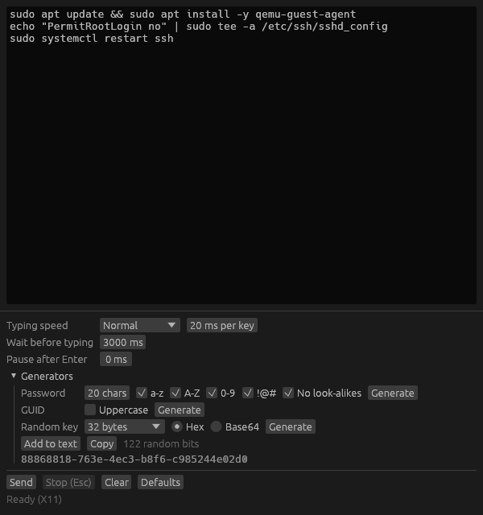

# SendKeys

Types text into whichever window has the focus, one key press at a time. Made for
remote consoles (noVNC and similar) that have no clipboard.

Paste or write the text, press **Send**, click into the target window during the
countdown, and the text is typed there. **Stop** or the **Escape** key interrupts
it. On X11, Windows and macOS Escape works from any window; on Wayland the app's
own window has to have the focus.

- **Typing speed**: time from one key press to the next. Slow it down if the
  console drops characters.
- **Wait before typing**: the countdown that gives you time to switch windows.
- **Pause after Enter**: extra wait after each line.
- **Generators**: password, GUID (version 4) and random key (hex or Base64), all
  from the operating system's secure random source. "Add to text" appends the
  result to the text box; "Copy" puts it on the local clipboard.

Settings are remembered between runs; **Defaults** resets them. The text and
generated values are never saved.

## Download

Ready-made executables are attached to each
[release](https://github.com/user3278/sendkeys/releases): a Linux binary, a
Windows `.exe` and a macOS app (Intel and Apple silicon). They are not signed
with a developer certificate, so the first start needs one extra step:

- **Windows**: SmartScreen may say it protected your PC. Choose *More info*, then
  *Run anyway*.
- **macOS**: right-click the app and choose *Open* (or allow it under *System
  Settings > Privacy & Security*). Then grant it *Accessibility* access when
  asked, which is what lets it type.
- **Linux**: `chmod +x sendkeys` after unpacking if needed.

## Build and run

    cargo build --release
    ./target/release/sendkeys

Build on the operating system you want to run it on. No extra system packages are
needed on Linux.

To publish a release, push a tag such as `v0.2.0` (after updating the version in
`Cargo.toml`); the *Release* workflow builds all three executables and attaches
them.

## How it types on each platform

| Platform | Method | Notes |
|---|---|---|
| Linux, X11 | XTest | Presses the real keys of the active layout, with Shift/AltGr as needed. |
| Linux, Wayland | RemoteDesktop portal | GNOME and KDE Plasma. The desktop asks for permission once. Other compositors (Sway, Hyprland) are not supported. |
| Windows, macOS | `enigo` crate | macOS asks for the Accessibility permission the first time. |

`SENDKEYS_BACKEND=x11` or `SENDKEYS_BACKEND=portal` overrides the Linux detection.

## Limits

- A remote console receives key presses, not characters, so the keyboard layout
  inside the VM has to match the one on your machine.
- On X11, characters that are not on your active layout are typed through a
  temporarily remapped key. Native programs accept that; browsers do not report
  the character for such a key, so a browser-based console may miss it. The app
  lists the affected characters when a run finishes.
- Caps Lock must be off on X11; the app refuses to start typing otherwise.

## Tests

    cargo test

Two more tests are opt-in because they touch the desktop:

    # types $SENDKEYS_TEST_TEXT into the focused window; use a scratch X server
    SENDKEYS_TEST_TEXT='hello' cargo test -- --ignored types_into_focused_window
    # opens and closes a portal session without asking for permission
    cargo test -- --ignored can_open_and_close_a_portal_session
